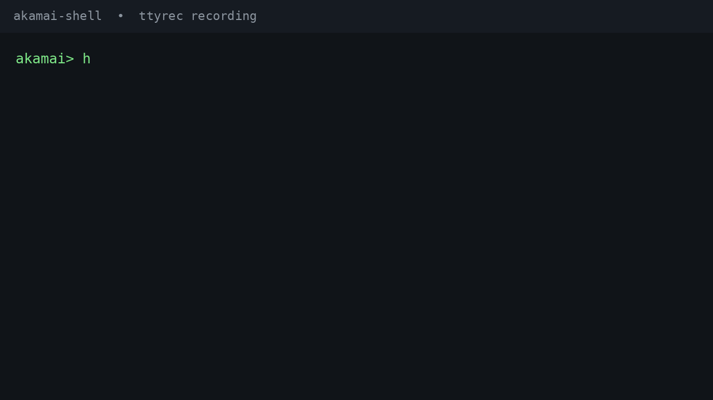

# Akamai Shell

`akamai-shell` is an interactive JavaScript-enabled console for calling
Akamai APIs directly. It solves the gap between one-off `curl`/HTTPie
commands and a full API client: requests use EdgeGrid authentication, API
paths and methods are validated from the checked-in OpenAPI documents, and
responses can be inspected, transformed, stored in variables, and reused in
later requests.



It is useful when you need to:

- Explore Akamai resources interactively without writing a client program.
- Reuse response data such as property IDs, versions, groups, and hostnames.
- Combine API calls with JavaScript expressions and local shell tools such as
  `jq`.
- Use the same generic request path for normal commands and tab completion.
- Record redacted HTTP exchanges while developing or troubleshooting scripts.

The shell currently includes modules for Property Manager, Cloudlets v2/v3,
Edge Diagnostics, Edge DNS/Config DNS, and DataStream Config. Supported
methods and paths vary by module; unsupported combinations fail explicitly.

## Installation and startup

Requirements: Node.js and an EdgeGrid resource file, normally
`~/.edgerc`.

Clone the repository with its checked-in API reference submodule:

```bash
git clone --recurse-submodules https://github.com/tai/akamai-shell.git
cd akamai-shell
```

For an existing checkout, initialize or update the submodules with:

```bash
git submodule update --init --recursive
```

```bash
npm install
npm start
```

To install the shell as a global CLI from a local checkout:

```bash
npm install -g .
```

For a development checkout, use a link instead:

```bash
npm link
```

Both commands install the `akamai-shell` executable, which can then be run
from any directory:

```bash
akamai-shell
```

Configure the credential file and section from inside the shell:

```text
akamai> config.edgerc = "~/.edgerc"
akamai> config.edgercSection = "papi"
```

Set the active API request target as one value. Use the identifiers from your
own account:

```javascript
config.target = {
  accountSwitchKey: "your-account-switch-key",
  contractId: "your-contract-id",
  groupId: "your-group-id"
}
```

Configuration and JSON-serializable session variables are persisted under
`~/.config/akamai-shell/`. Credential values and secret request headers are
never displayed or persisted by the shell.

Structured settings can be changed with dotted `set` paths. For example:

```text
set target.accountSwitchKey foo
set target.contractId bar
set target.groupId baz
```

The equivalent JavaScript form is `config.target = { ... }`. The existing
top-level `set accountSwitchKey`, `set contractId`, and `set groupId` commands
remain as shorthand.

## Running scripts

`akamai-shell` can execute a file of shell commands non-interactively:

```bash
akamai-shell script-file
```

This also works as an executable script with a shebang line:

```bash
#!/usr/bin/env akamai-shell
val = 123
echo $val
```

Make the file executable (`chmod +x script-file`) and run it directly. The
shebang line, if present, is ignored. Script mode reuses the same command
parser, JavaScript evaluator, variables, and pipelines as the interactive
shell, and supports explicit executable JavaScript state files through
`save [path]` and `load [path]`; it does not automatically persist session
changes. The process exits with a
non-zero status if a command fails or the script file cannot be read, and
with status 0 on normal completion or an explicit `exit`/`quit`. This is a
minimal, currently supported subset of script execution; see #65 for further
script-mode work such as positional arguments.

If present, `~/.config/akamai-shell/startup.js` is evaluated when the backend
starts. It can define default variables or adjust `config`; an explicit
`load` command can then override those defaults from `state.js`.

A JavaScript statement may span multiple lines; consecutive lines are joined
until brackets, braces, parentheses, and quotes are balanced, so a `for`/`if`
block or multi-line object/array literal executes as one statement:

```bash
#!/usr/bin/env akamai-shell
data = []
for (let i = 0; i < 100; i++) {
  data[i] = $('get /papi/v1/properties')
}
show data
```

A script that ends with an unterminated statement (e.g. a missing closing
brace) exits with a non-zero status and a clear error. This multi-line
joining currently applies only to script files, not the interactive shell,
where each line is still executed as it is entered.

JavaScript code (in scripts and interactively) can use the real Node.js
`process` object and a `require()` function, just like a normal Node.js
script:

```bash
#!/usr/bin/env akamai-shell
os = require('os')
show os.hostname()
show process.argv
```

Arguments after the script path are available through `process.argv`, using
the usual Node.js layout: `process.argv[0]` is the Node executable,
`process.argv[1]` is the script path, and `process.argv[2]` onward contain
the arguments passed to the script:

```bash
akamai-shell script.as foo bar
# process.argv[2] === "foo"
# process.argv[3] === "bar"
```

In a script, `require()` resolves relative paths and `node_modules` against
the script file's own directory. In the interactive shell, it resolves
against the shell's current working directory. `process`/`require` are not
persisted to state files, listed by `show` (with no
arguments), or offered as variable-name completions.

Common Node.js globals are also available in the native Node.js backend, including
`Buffer`, `URL`, `URLSearchParams`, `AbortController`, `Blob`, `FormData`,
`Headers`, `Request`, `Response`, `setTimeout`, `setInterval`,
`setImmediate`, `queueMicrotask`, `structuredClone`, `performance`, and
`fetch` when supported by the installed Node.js version. `global` aliases
the backend's `globalThis`.

## Quick command reference

| Command | Purpose |
| --- | --- |
| `get <api-path> [name==value ...]` | Make an authenticated GET request. |
| `post <api-path> [name=value ...]` | Make a JSON POST request. |
| `put <api-path> [name=value ...]` | Make a JSON PUT request. |
| `post|put -v <expression> <api-path>` | Use a JSON-serializable JavaScript value as the complete body. |
| `get -f <file> <api-path>` | Write formatted GET JSON to a file. |
| `post|put -f <file> <api-path>` | Read a JSON request body from a file. |
| `find <api-path> -q <rule>` | Fetch one response and find matching dictionaries locally. |
| `set <name> <value>` | Set a known configuration value; JavaScript assignment supports arbitrary values. |
| `show [expression]` | Display the session namespace or one JSON value. |
| `echo <text> [\| command]` | Print expanded text, optionally through a local shell pipeline. |
| `record auto\|on\|off` | Control redacted in-memory request recording; `auto` keeps the latest request only. |
| `record show [--http]` | Display captured JSONL or HTTP-style records. |
| `history` | Display command history. |
| `save [file]` | Save portable user variables and functions as executable JavaScript. |
| `load [file]` | Load an executable JavaScript state file. |
| `help` / `?` | Display command help. |
| `exit` / `quit` | Leave the shell. |
| `! <command>` | Run a local shell command. |

Body fields use HTTPie-style syntax:

```text
post /edge-diagnostics/v1/curl url=https://example.test timeout:=30 enabled:=true
put -v "$payload" /some/path name=updated
```

`name=value` merges a string field into a POST or PUT JSON body. `name:=value`
parses the value as JSON, so numbers, booleans, arrays, objects, and `null`
remain typed. Query parameters use `name==value` for all methods, either in
the path or as separate arguments. GET arguments must use the `==` form.
With `-v`, the referenced JSON object is used as the initial body and
parameter arguments merge over it.

API paths include their service prefix, for example:

```text
get /papi/v1/properties
get /cloudlets/v3/policies/371861/versions
get /edge-diagnostics/v1/curl
```

Press Tab while entering a command to complete command names, static API
segments, query parameters, and dynamic identifiers fetched from collection
endpoints. Completion is method-aware for `get`, `post`, and `put`; write
commands can use read-only descendants when the API metadata does not declare
a write operation for that descendant. A collection completion inserts `/` so
the next Tab can request dynamic IDs. Failed or empty completion lookups
remain silent.

Type `?` in an API command to display the parameters supported at that
position. Parameter help is derived from the OpenAPI metadata, preserves the
input buffer, and distinguishes query fields (`name==value`) from string body
fields (`name=value`) and typed JSON body fields (`name:=value`). A literal
question mark inside quotes is not treated as help.

## JavaScript integration

Lines that are not shell commands are evaluated as JavaScript in the current
session. Values can be assigned, updated, indexed, filtered, and passed to
later requests:

```javascript
config.target = {
  accountSwitchKey: "your-account-switch-key",
  contractId: "your-contract-id",
  groupId: "your-group-id"
}

groups = await $("get /papi/v1/groups")
groups.groups.items

matching = groups.groups.items.filter(group =>
  group.groupName.includes("production")
)
```

The asynchronous `$()` helper runs an internal GET and returns the decoded
response body without printing the nested command output. It also supports a
local pipeline:

```javascript
properties = $(`get /papi/v1/properties | jq '.properties.items[]'`)
```

It can also capture a local shell command. This is useful for loading external
JSON into the JavaScript session:

```javascript
foo = $('! cat foo.json')
```

Shell output is parsed as JSON when possible; non-JSON output remains a string.

The `echo` command can pipe expanded JSON variables to local tools:

```text
echo "$foo" | jq '. | keys'
```

JavaScript values can be used as complete POST or PUT bodies. Quoting a
variable keeps a JSON value containing spaces or quotes together:

```javascript
rules = await $("get /papi/v1/properties/prp_example/versions/1/rules")
```

```text
put -v "$rules" /papi/v1/properties/prp_example/versions/1/rules
```

The shell also supports property and index expansion in command arguments:

```text
get /papi/v1/properties/$properties["properties"]["items"][0]["propertyId"]
show matching[0]
```

Functions are available for the current session, but external Node.js module
loading is available through the backend's `require()` function. Function
values are not persisted as environment JSON. Add a semicolon to suppress the
display of a JavaScript statement's result, for example `value = 123;`.

The `history` command prints a numbered list and can be piped to local
commands. `record auto` keeps the latest completed redacted request,
`record on` keeps all requests, and `record off` disables capture. `record
show` prints JSONL while `record show --http` prints HTTP-style traces.
Commands beginning with `!` run through the local shell, so both `!pwd` and
`! pwd` are valid. Ctrl+R starts reverse incremental history search; accept a
match with the normal readline editing keys before executing it.

## Example interactive session

```text
$ npm start
akamai> config.edgerc = "~/.edgerc"
akamai> config.edgercSection = "papi"
"papi"
akamai> groups = await $("get /papi/v1/groups")
akamai> groups.groups.items.filter(g => g.groupName.includes("production"))
[
  {
    "groupName": "production",
    "groupId": "grp_example",
    "parentGroupId": "grp_parent",
    "contractIds": ["ctr_example"]
  }
]
akamai> get /papi/v1/properties groupId==grp_example
{
  "properties": {
    "items": [
      {
        "propertyId": "prp_example",
        "propertyName": "www.example.com",
        "latestVersion": 12
      }
    ]
  }
}
akamai> properties = await $("get /papi/v1/properties groupId==grp_example")
akamai> find /papi/v1/properties -q 'propertyName=~example'
[
  {
    "path": "/papi/v1/properties/prp_example",
    "resource": {
      "propertyId": "prp_example",
      "propertyName": "www.example.com",
      "latestVersion": 12
    }
  }
]
akamai> get /papi/v1/properties | jq '.properties.items[] | .propertyName'
"www.example.com"
akamai> exit
```

`find` makes exactly one GET request for the supplied path and scans that
response locally; it does not recursively fetch child resources.

## Development

Run the test suite with:

```bash
npm test
```

The executable entry point is `src/main.js`. API-specific behavior lives in
modules under `src/apis/`, while the generic transport, request parsing,
completion, and JavaScript session behavior are implemented in `src/`.
